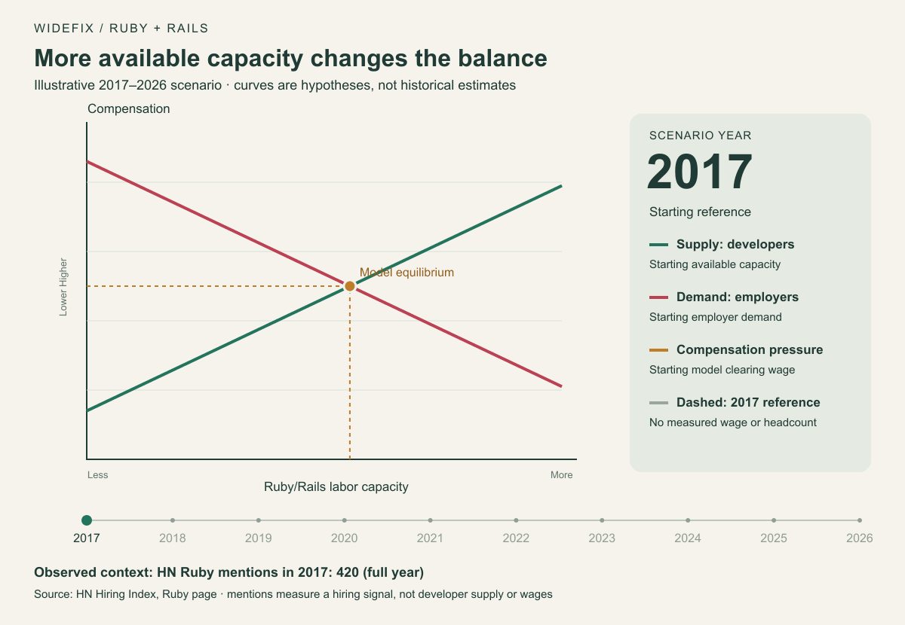
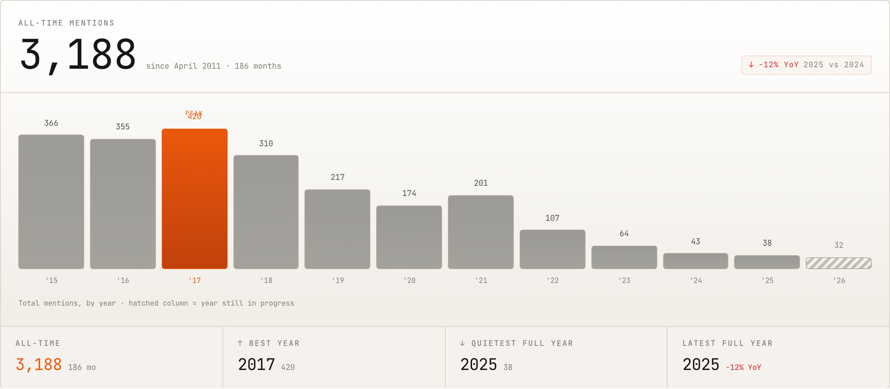

My view of the Ruby job market starts with supply: more Ruby/Rails development capacity is available relative to the work employers are offering. That gives companies more choice and makes finding the next role harder for developers.

I think this imbalance also contains the mechanism that can eventually reduce it. When a market offers fewer attractive opportunities, people change their plans. Developers move to other work. Newcomers choose a different language. Meanwhile, businesses that can hire Rails experience more affordably have a reason to invest.

That is the supply-and-demand argument I want to explore. **More available developers can put pressure on pay now while creating the conditions for a tighter market later.** The adjustment takes time, and it depends on Rails businesses continuing to need the work.

## Supply means developers offering their work

In this article, supply means Ruby/Rails developers willing and able to work at a given level of compensation. Demand means the Ruby/Rails work employers are willing and able to pay for. Salary or a contractor's rate is the price connecting them.

A vacancy is employer demand. A developer looking for a role is labor supply. Mixing those up reverses the argument.

The number of people who know Ruby does not have to grow for employers to see more available candidates. An experienced Rails developer can move from a full workload to looking for their next project. Several people can become available when one Rails team closes. These are ways availability can increase; I am not claiming a measured count of either event.

There is another route to the same competitive pressure: fewer openings can leave the existing pool of candidates competing for less work. Technically, that is a fall in demand rather than an increase in the supply curve. Both can produce excess supply at the previous going rate.

My starting hypothesis is greater available capacity relative to demand. The indexes below help describe the hiring side; none directly counts available Ruby/Rails developers.

<figure>
  <picture>
    <source media="(prefers-reduced-motion: reduce)" srcset="../images/ruby-supply-demand-2017-2026.png">
    
  </picture>
  <figcaption>My supply-and-demand hypothesis, animated across 2017–2026. Curve positions and compensation are illustrative, not measured historical estimates. HN Ruby mentions are shown separately as hiring context; they do not determine these curves. The animation loops; readers who prefer reduced motion see the final frame.</figcaption>
</figure>

### How to read the animation

Think of the chart as developers looking for paid work and companies deciding how much work they can afford. Higher on the chart means higher pay. Further right means more developer time, which could mean more people or more hours of work.

The green supply line shows how much work developers would offer at each pay level. The red demand line shows how much companies would buy. The orange dot is where those lines meet: the model's **equilibrium**, where the amount of work offered matches the amount companies want to buy at that pay level.

The orange horizontal segment answers a different question: **what if pay stayed at the animation's starting level while the market changed?** Its left end shows how much work companies would buy at that pay. Its right end shows how much developers would offer. The gap between them is the “excess supply”: developers have more time available than companies want to hire at that price. It is a gap rather than a dot because it compares two different quantities at the same pay level.

For example, imagine 100 equally qualified developers willing to work at a particular salary, but companies willing to hire only 70 at that salary. The excess supply is the remaining 30 developers. Those numbers are made up to explain the idea; they are not Ruby market estimates.

That competition can give employers more room to negotiate lower offers. In the animation, the orange dot moves down as the modeled balance changes. Actual salaries do not all move together or adjust immediately. And “2017 model wage” means the animation's illustrative starting pay level, not a measured Ruby salary from 2017.

## What the Ruby/Rails indexes tell us

I am interested in Ruby and Rails here, so an increase in total technology vacancies would not answer my question. Even the Ruby-only and Rails-specific series need to stay separate.

| Source | Ruby/Rails evidence | How I read it |
| --- | --- | --- |
| [HN Hiring Index: Ruby](https://www.adamtal.me/hacker-news-hiring-index/languages/ruby) | Annual Ruby mentions fell from 420 in 2017 to 38 in 2025 | A much smaller visible Ruby hiring channel than at its earlier peak |
| [IT Jobs Watch: Ruby](https://www.itjobswatch.co.uk/jobs/uk/ruby.do) | UK permanent ads citing Ruby: 326 in the six months to October 27, 2026, versus 130 in the comparable 2025 window; median advertised salary £63,373 versus £70,000 | More advertisements alongside a lower advertised median |
| [IT Jobs Watch: Ruby on Rails](https://www.itjobswatch.co.uk/jobs/uk/ruby%20on%20rails.do) | UK permanent ads citing Rails: 169 in the six months to October 26, 2026, versus 35 a year earlier; median advertised salary £75,000 versus £70,000 | A recovering UK Rails hiring sample, with a rising median |

*Checked October 27, 2026. These sources cover different populations and periods; their counts should not be added together.*

*Original chart from the [HN Hiring Index Ruby page](https://www.adamtal.me/hacker-news-hiring-index/languages/ruby). The hatched 2026 column is a partial year, so my long-run comparison uses completed years.*

The lower Ruby advertised median is consistent with price pressure, but a different mix of roles could also explain it. The Rails-specific UK figures show that rising advertised pay can coexist with the longer HN decline. Ruby and Rails ads also overlap; they are not two independent markets we can sum.

I read this as a market with different local conditions, rather than a universal salary collapse. To establish increased supply directly, I would want comparable counts of qualified applicants per Rails vacancy, available contractors, and time spent finding work.

## First comes pressure on compensation and bargaining power

The basic [labor-market model](https://openstax.org/books/principles-economics-3e/pages/4-1-demand-and-supply-at-work-in-labor-markets) predicts that an increase in supply, with demand unchanged, lowers equilibrium compensation and increases employment. A fall in demand instead lowers both equilibrium compensation and employment. That distinction matters when interpreting fewer vacancies.

For a Rails developer, the pressure can appear before a visible salary cut: fewer competing offers, less room to negotiate, or a longer gap between contracts. Existing salaries can stay unchanged while new offers become less attractive. These are implications of the hypothesis, not measurements from the indexes.

Imagine a Rails business that previously struggled to find someone within its budget. If several suitable developers become available, it can compare candidates and negotiate. The developers now need to compete for that particular piece of work.

That does not mean every developer becomes interchangeable. Someone who can safely take over billing, deployments, and production incidents offers a different service from someone who needs close supervision. The relevant supply is the capacity to do the job the owner actually needs.

## Then developers respond to the incentives

This is the part that makes me cautious about projecting today's availability indefinitely.

If Rails work becomes harder to find or pays less attractively than a developer's alternatives, some developers will spend more time on those alternatives. Someone choosing their first framework may choose another one. A contractor may stop reserving capacity for Rails projects.

That response can gradually reduce the supply offered to Rails employers. It does not require everybody to abandon Ruby. A relatively small change in available experienced capacity could matter to a business with a specific hiring need.

There is a delay, though. People have existing skills, clients, and commitments. They do not change careers whenever a job board has a quiet month. Likewise, someone leaving Rails work may return if conditions improve.

**My expectation is that persistent weak opportunities would discourage future Ruby/Rails supply.** That is an economic prediction about incentives, not a finding that the developer population has already started shrinking.

## More affordable Rails work can bring postponed projects back

Employers respond too.

Consider an owner with an established Rails application and a backlog of upgrades, slow reports, and unreliable imports. Some improvements may have been postponed because the expected benefit did not justify the cost. If suitable development capacity becomes more affordable, some of those projects can become worthwhile.

That is an increase in the quantity of work purchased as its price falls. It does not require a sudden new wave of Rails startups.

For an existing application, the owner's decision is concrete: what does keeping this product useful cost, and what does that investment return? An application supporting paying customers can justify ongoing work even when its framework attracts fewer headlines.

This response has limits. A business without the budget or a viable product will not necessarily hire at a lower rate. But where cost was the obstacle, greater developer availability can help turn a backlog into paid work.

## The next phase depends on which side adjusts faster

My expected sequence is a period of stronger competition among available developers, followed by adjustment on both sides. Some capacity leaves the Rails market, while some employers buy work they previously postponed.

That can reduce the initial imbalance. It does not automatically produce a shortage or restore past salaries.

| What changes next | Expected effect |
| --- | --- |
| Available Rails capacity stays high and employers keep budgets tight | Continued pressure on new offers and rates |
| Developers leave Rails work faster than demand falls | Less excess supply and improving bargaining power for those available |
| Lower delivery costs make more Rails projects worth funding | More paid work absorbs some available capacity |
| Demand later strengthens after experienced capacity has left | Possible hiring bottlenecks and upward pressure on compensation |

The last case is why I would not assume that a buyer's market lasts forever. Experience takes time to build. If employers later need more Rails capacity, replacing people who moved on may be slower than reopening a vacancy.

A rebound becomes more plausible when supply contracts while viable Rails businesses keep investing. If the work disappears faster than developers leave, that rebound may never arrive. The mechanism is conditional; it is not a promise that waiting will make every Ruby developer scarce.

## What I would do with this view

As a Ruby developer, I would prepare for competition today and build the experience that will still matter after the market adjusts. Taking responsibility for a Rails application means understanding its business rules, investigating failures, improving tests, planning upgrades, and keeping releases dependable.

I would also keep other skills usable. Having alternatives makes it easier to choose Rails work on reasonable terms and stay in it sustainably.

As an application owner, I would use greater availability to address maintenance and ownership gaps. Hiring becomes more useful when someone can understand the application and continue looking after it. Setup instructions, access, tests, and documented deployment steps help turn an available developer into effective capacity.

At WideFix, we [take over existing Ruby on Rails applications](/ruby-on-rails-application-takeover) and provide [ongoing maintenance](/ruby-on-rails-maintenance). That connects directly to this economic argument: an existing product has work that needs an owner, while available Rails experience needs a business problem worth solving.

If maintenance has been postponed or your application has lost its technical owner, list the critical workflows, outstanding upgrades, and recurring production problems. Use that list to start a [Rails application takeover discussion](/ruby-on-rails-application-takeover) and assess what it would take to keep the product moving.

I remain optimistic about Ruby. Greater available supply can make this a difficult period for developers, but it also changes incentives. My bet is that useful Rails applications and the people willing to take responsibility for them will keep finding reasons to work together as the market adjusts.
