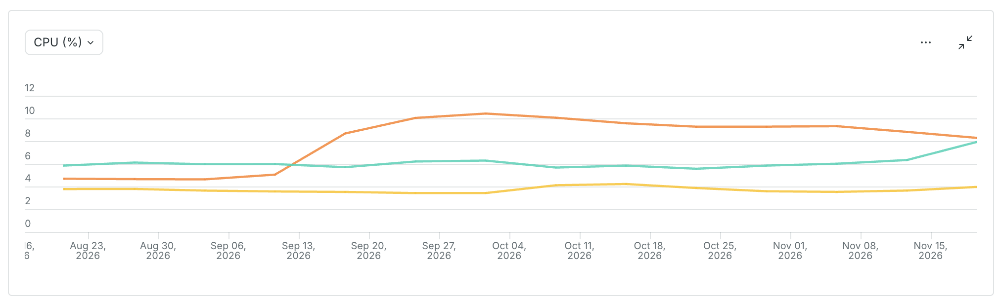
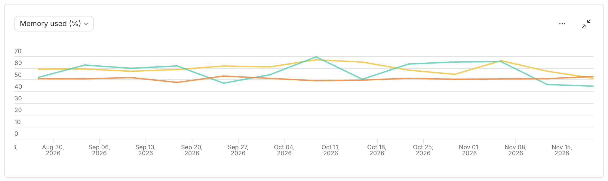
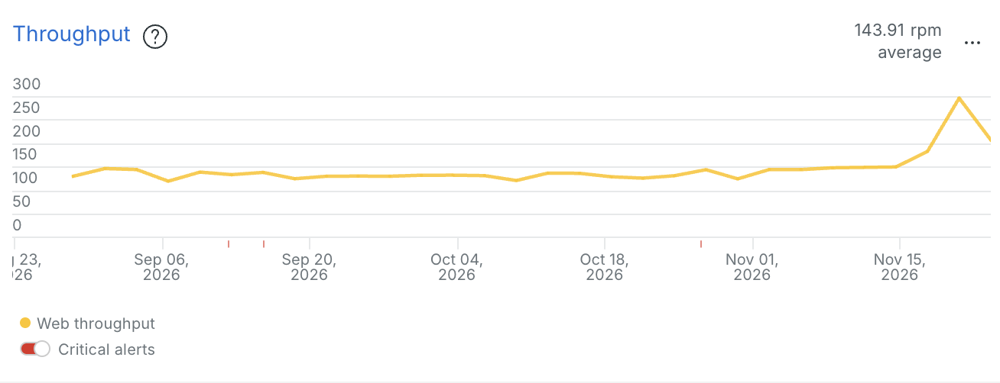
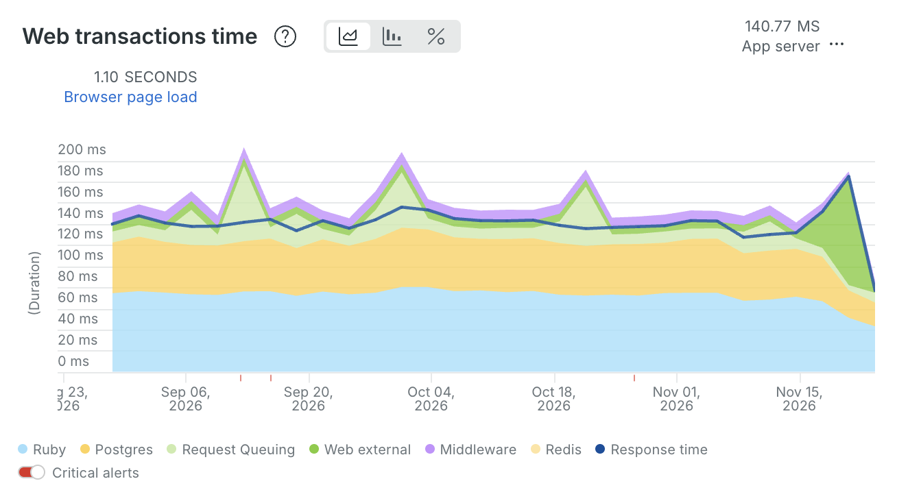
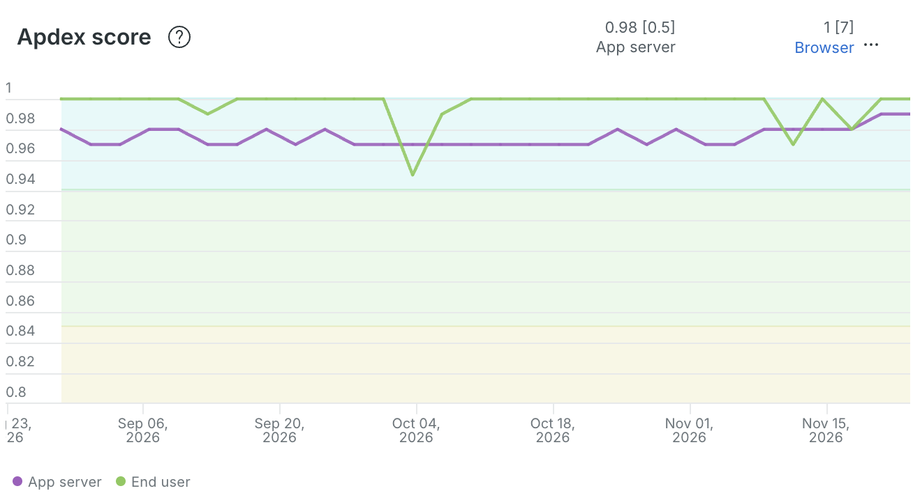

## It all starts with a question: How many servers do we need?

15 years ago I was at starting point of my software development career. I had about 2 years of experience when an ambitious startup asked me a tricky question. This startup aimed to dominate the global market and attract millions of users. It was like eBay but focused on a specific niche and targeted artisans. I didn't even have experience maintaining an app in production. The question was, "**How many servers would we need?**" That question shocked me. I felt my mind blanking, as if a power failure had shut down my thoughts. I couldn't find an answer. I thought, "I need to find a precise number. If I don’t, I'm doomed." I tried to solve this puzzle mathematically. I read articles online about the topic. Still, I couldn't escape that trap. How wrong I was! I wasted hours and days on useless work.

## Be simple

I see my mistake clearly now — after 16 years of school and university, I still **struggled to think outside the box**.

Over the years, I’ve learned that a startup is about more than technical details. It’s also not about immediately implementing the idea exactly as initially described. The success depends more on understanding the people we serve and the value we offer.

Now, over a decade later, that question makes me smile. I would simply say, "**You need one small, cheap server.**" Why? Let’s explore.

## Focus on business problems

Today, I maintain legacy Ruby on Rails applications. We often joked about the challenges of maintaining such applications. We used to associate legacy with code that is too poor and hard to understand and maintain. People viewed "Legacy" as a negative term, almost a curse for IT projects. We owe all that to popular, authoritative authors. We also owe it to our interpretation of their standards.

The apps I manage are definitely legacy. When I inherit apps, they usually have security, performance, SEO, and infrastructure problems. Still, they generate revenue. Their product code and infrastructure might be a bit too basic. But it gets the job done! These apps serve both the business and the customers well. With some tuning, I fix all the issues above. This gives the business another boost to its growth potential.

I notice a pattern in these applications. The people behind these applications focused on business problems, not tech issues. They didn’t aim to create perfect software architecture. They also didn’t aim to build flawless infrastructure. I see why these products succeed. They prioritized serving their customers above all.

I'm not saying that investing in solid infrastructure and architecture is useless. It's an important consideration. But it shouldn't be the focus at the start when the product generates no revenue and lacks proof of success. The earlier startups I inherited seem to have understood this principle. They did so from the start. That's why they are not startups now, but successful businesses. This insight comes from effective product management and savvy executives. Sometimes, luck plays a part too.

## One example that illustrates this principle

Let's see the following numbers that support my thoughts above. I pick one IT product to show how it works on practice. It has been in production since 2015. It's built on **Ruby on Rails**. This observation will help me to explain why I think that having one small server is enough.

### Active users

In the last 30 days, 9,506 users accessed the iOS or Android app. Combined web and mobile had 14,763 active unique users.

Login-session activity through Nov 24, 2026

| Timeframe | Mobile App | Web and Mobile |
| --- | ---: | ---: |
| Last 24 hours | 1,011 | 1,703 |
| Last 7 days | 4,629 | 7,186 |
| Last 30 days | 9,506 | 14,763 |

11,137 subscriptions were active in the latest Stripe snapshot, dated Nov 21, 2026.

### The server

Daily averages from the server’s logs, Nov 16–24, 2026:

| Date | CPU busy | RAM used |
| --- | ---: | ---: |
| Nov 16 | 5.8% | 43.4% |
| Nov 17 | 6.4% | 55.2% |
| Nov 18 | 6.7% | 64.8% |
| Nov 19 | 6.6% | 66.0% |
| Nov 20 | 7.9% | 63.4% |
| Nov 21 | 9.8% | 61.4% |
| Nov 22 | 10.4% | 46.8% |
| Nov 23 | 8.0% | 65.5% |
| Nov 24 | 5.8% | 52.8% |

The Ruby on Rails app runs on a single virtual machine with 4 vCPUs and 8 GB of RAM. We host the database hosted on its own virtual machine. We also have Web, iOS and Android front-end apps that connect to the back end via an API.

#### Production monitoring

These production dashboards cover a longer period than the daily averages above.

<figure>
  
  <figcaption>CPU utilization stayed below 12% in the chart.</figcaption>
</figure>

<figure>
  
  <figcaption>Memory use ranged from roughly 45% to 70% in the chart.</figcaption>
</figure>

<figure>
  
  <figcaption>Web throughput averaged 143.91 requests per minute.</figcaption>
</figure>

<figure>
  
  <figcaption>The dashboard shows 140.77 ms for app-server response time and 1.10 seconds for browser page load.</figcaption>
</figure>

<figure>
  
  <figcaption>Apdex, a measure of response-time satisfaction, was 0.98 for the app server and 1.00 for the browser.</figcaption>
</figure>

This setup is much easier than the alternative one with a load balancer. It reduces complexity and operational overhead, simplifies maintenance and troubleshooting. And hence it is **cost-effective**.

If there's a problem, we can add more RAM to the server. So the app is secured for now. That might happen, so we may not need to add more servers to our infrastructure and never come up with a load balancer, that would be more expensive solution. Keeping the infrastructure simple, saves the client a thousand bucks each month. They can invest that money in more important areas like marketing, branding, business and data analysis.

These are numbers that support this potential growth:

| Month   | Active users | MoM    | Logins |
|---------|-------------:|-------:|-------:|
| 2025-01 | 10,356 |      — | 37,161 |
| 2025-02 | 10,544 |  +1.8% | 35,308 |
| 2025-03 | 11,613 | +10.1% | 40,646 |
| 2025-04 | 11,962 |  +3.0% | 38,480 |
| 2025-05 | 11,348 |  −5.1% | 32,516 |
| 2025-06 | 11,086 |  −2.3% | 31,330 |
| 2025-07 | 11,442 |  +3.2% | 32,755 |
| 2025-08 | 12,127 |  +6.0% | 34,671 |
| 2025-09 | 12,422 |  +2.4% | 34,966 |
| 2025-10 | 12,553 |  +1.1% | 35,737 |
| 2025-11 | 12,049 |  −4.0% | 33,099 |
| 2025-12 | 11,202 |  −7.0% | 28,214 |
| 2026-01 | 13,340 | +19.1% | 36,848 |
| 2026-02 | 13,212 |  −1.0% | 35,258 |
| 2026-03 | 14,783 | +11.9% | 42,074 |
| 2026-04 | 14,607 |  −1.2% | 39,629 |
| 2026-05 | 13,890 |  −4.9% | 36,572 |
| 2026-06 | 13,589 |  −2.2% | 35,040 |
| 2026-07 | 13,679 |  +0.7% | 36,626 |
| 2026-08 | 14,622 |  +6.9% | 39,580 |
| 2026-09 | 14,840 |  +1.5% | 38,550 |
| 2026-10 | 14,666 |  −1.2% | 37,468 |

There are about 20% more active users each year.

For this product, the simple architecture is the key to sustainable growth.

## What about AI vibe-coded projects

I once inherited a commercial vibe-coded project. Unfortunately, it never gained traction due to market fit issues and low sales. Choosing the right product and timing is crucial. But even without real users, I noticed several technical problems in the code:

- Overcomplicated architecture
- Excessive lines of code
- Bloated, overly complex UI

These issues stood out when I compared this app against apps with real users. AI often makes things complicated from the start. This makes it hard to launch a product built solely through vibe coding. It lacks proper QA and checks to see if it fits the market.

We create vibe-coded products internally for our team, and I see these same issues. While we can manage them internally, paying customers won't tolerate them.

It doesn't matter who or what complicates things from the start, though. The overcomplication can be made by both humans and AI. The crucial part is that once you have it too complicated from a start it will be very hard to move forward later. It's a lost opportunity and potential growth.

## Conclusion

Keeping tech simple is an important part of unlocking a business's growth potential. Start with simple flat tech. **Ruby on Rails** is a perfect fit for building an MVP. It's been like that since its early rise and it is still relevant in 2026 in AI era. And I'm pretty sure it will be like that in 2027. And yeah — start with one server and adjust when necessary. Even if you are going to take over the world.

While AI accelerates software development, it won't replace people. IT products serve human needs. So human insight remains essential to building useful products.

At WideFix, we [take over existing Ruby on Rails applications](/ruby-on-rails-application-takeover), take technical ownership, and provide [ongoing Rails maintenance](/ruby-on-rails-maintenance). If you've inherited an app and aren't sure what to change first, start with how customers use it today and where the current setup is actually causing problems.
